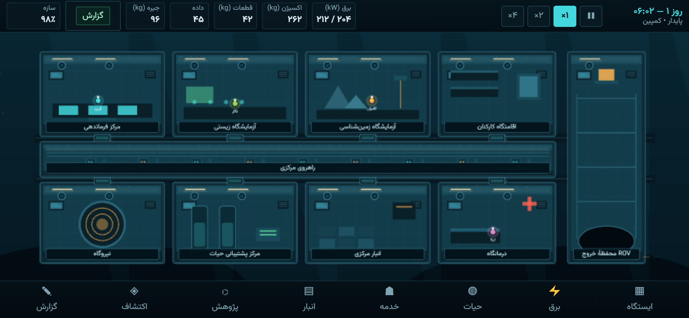
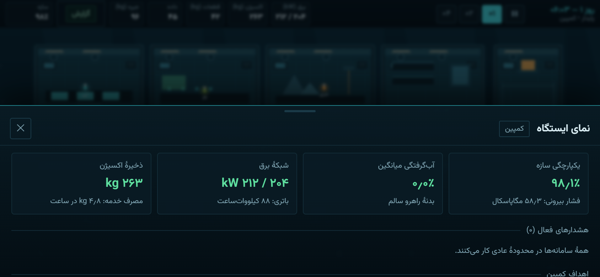
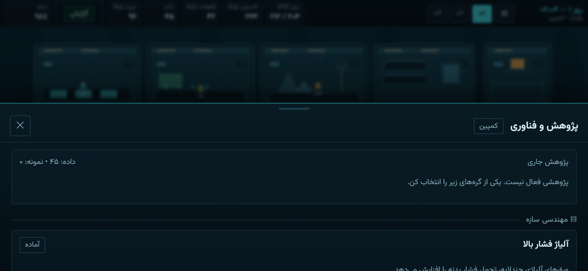

# BENTHIC-9 | بنتیک-۹ — ایستگاه اعماق

شبیه‌سازی بقا و مدیریت ایستگاه تحقیقاتی در عمق ۵۸۰۰ متری اقیانوس آرام.
بازی ابتدا وب است و با Capacitor به اپلیکیشن اندروید (فقط افقی) تبدیل می‌شود.



| نمای ایستگاه | پنل پژوهش |
|---|---|
|  |  |

## اجرا

```bash
npm install
npm run dev        # http://127.0.0.1:5173
npm run build      # بیلد تولیدی در dist/
npm test           # تست‌های شبیه‌سازی (Vitest)
npx playwright test # تست جریان‌های رابط (نیاز به مرورگر)
```

## ساخت اندروید

```bash
npm run build
npx cap sync android
cd android && ./gradlew assembleDebug
```

APK در `android/app/build/outputs/apk/debug/app-debug.apk` ساخته می‌شود. در GitHub Actions
این کار به‌صورت خودکار انجام و APK به‌عنوان artifact (و در صورت انتشار release، به صفحهٔ
انتشار) پیوست می‌شود.

## دریافت بازی

- **ریلیز v0.1.0 (APK دیباگ):** https://github.com/khiyarusa/benthic-9/releases/tag/v0.1.0
- مخزن خصوصی است؛ برای دانلود باید با حساب `khiyarusa` وارد شوی.
- SHA-256 فایل APK: `9F0B4A2ED7AF5314DF200F43E53B576B2C15809AC9C25F1648E36631B710B4B1`

## وضعیت فعلی

| بخش | وضعیت |
|---|---|
| شبیه‌سازی هسته (فشار، سازه، سیل، برق، حیات، حرارت) | پیاده‌سازی و تست‌شده |
| خدمه، وظایف خودکار، ناوبری، نیازها | پیاده‌سازی و تست‌شده |
| پژوهش (۹ گره، ۴ شاخه)، انبار، ساخت قطعه | پیاده‌سازی و تست‌شده |
| ROV و اکتشاف | پیاده‌سازی و تست‌شده |
| رابط فارسی RTL، پنل‌ها، ذخیرهٔ محلی | پیاده‌سازی و در مرورگر تأیید شده |
| برش جانبی ایستگاه در Phaser | پیاده‌سازی و در مرورگر تأیید شده |
| بستهٔ اندروید و قفل چرخش افقی | پیکربندی شده؛ APK در Actions ساخته و به ریلیز پیوست شد |
| صدا | جلوه‌های کوتاه WebAudio؛ موسیقی محیطی ندارد |
| محتوای روایی کمپین | حداقلی (شش هدف متنی) |
| آزمون روی دستگاه واقعی | انجام نشده |

## ساختار

```
src/sim/        هستهٔ شبیه‌سازی مستقل از React و Phaser
src/game/       صحنهٔ Phaser و برش جانبی ایستگاه
src/ui/         رابط React، پنل‌های مدیریتی و صفحات
src/state/      پل ارتباطی شبیه‌سازی و React
src/audio/      جلوه‌های صوتی کوتاه
tests/          تست‌های Vitest و Playwright
docs/           معماری، مدل شبیه‌سازی، نقشهٔ راه و وضعیت
android/        پروژهٔ Capacitor اندروید
```

جزئیات بیشتر: [ARCHITECTURE.md](docs/ARCHITECTURE.md) — [SIMULATION_MODEL.md](docs/SIMULATION_MODEL.md) —
[ROADMAP.md](docs/ROADMAP.md) — [PROGRESS.md](docs/PROGRESS.md)
