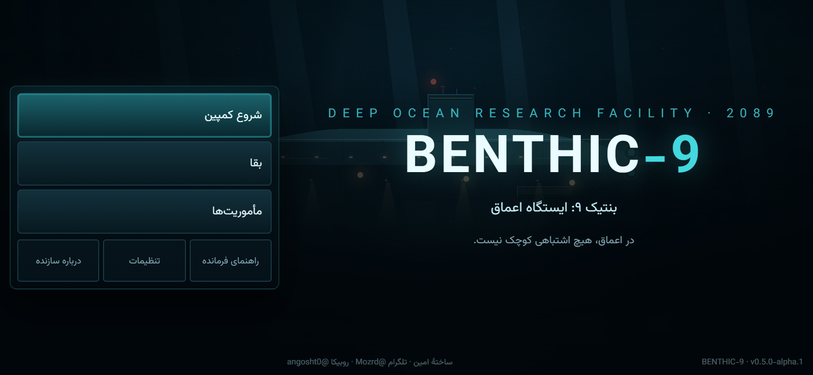
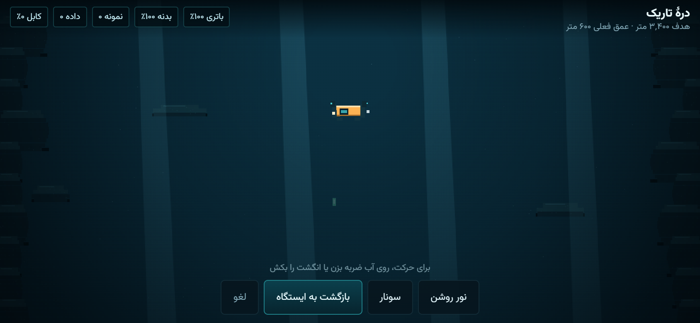
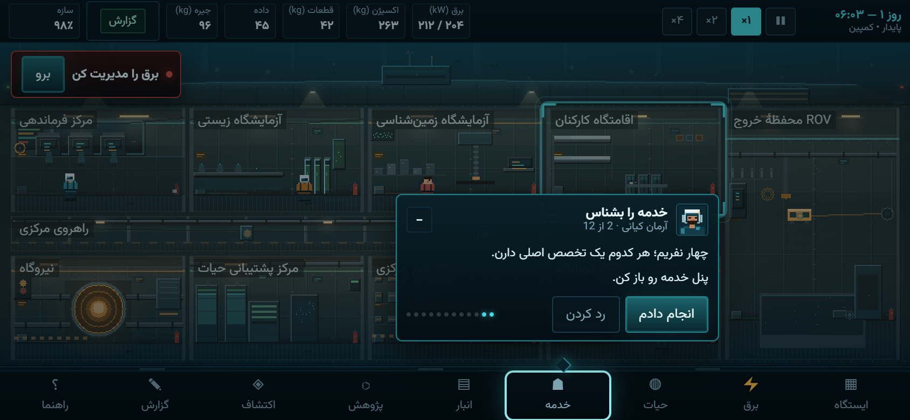

# BENTHIC-9 | بنتیک-۹ — ایستگاه اعماق

شبیه‌سازی بقا و مدیریت ایستگاه تحقیقاتی در عمق ۵۸۰۰ متری اقیانوس آرام.
بازی ابتدا وب است و با Capacitor به اپلیکیشن اندروید (فقط افقی) تبدیل می‌شود.



| آموزش «اولین شیفت فرمانده» | نمای ایستگاه در ۲۰:۹ |
|---|---|
|  |  |

## تازه در V6

- بافت‌های فتوگرامتری واقعی (CC0) در زمین شیرجه و رابط فلزی
- صدا و موسیقی ضبط‌شده، میکسر چهارباسه، موسیقی تطبیقی
- روایت فارسی فرمانده و دکتر کاویانی با زیرنویس
- کمپین سه‌پرده‌ای با ۱۲ مأموریت و کدکس ۱۰ یادداشتی
- نوار هدف بعدی و حالت ساده/پیشرفته

## تازه در V5

- شیرجهٔ واقعی ROV: پنج زیستگاه، کنترل لمسی، چراغ، سونار، کابل و باتری
- نمونه و کشف واقعی که به انبار، پژوهش و گزارش ایستگاه اضافه می‌شود

## تازه در V4

- آموزش به مربی شناور تبدیل شد: کارت کوچک، جای‌گذاری هوشمند، اسپات‌لایت بدون مسدودکردن هدف
- منوی اصلی با نقاشی شناور، پرتو نور، برف دریایی و گزینه‌های واقعی (راهنما، تنظیمات، درباره سازنده)
- پرترهٔ پیکسلی راهنما هم‌خانواده با کاراکترهای داخل بازی

## تازه در V3

- رندر در وضوح واقعی صفحه (DPR) و رفع نرمی تصویر روی گوشی
- صحنهٔ بازنویسی‌شده روی بافت‌های پخته: بدنهٔ شناور، برج فرمان، نورافکن، ۱۰ اتاق نقاشی‌شده
- خدمهٔ پیکسلی متحرک و دکور کارگاهی در همهٔ اتاق‌ها
- نوار «اقدام بعدی» که از وضعیت واقعی شبیه‌سازی محاسبه می‌شود
- آیکون و اسپلش اختصاصی

## تازه در V2

- چیدمان کاملاً واکنش‌گرا: از گوشی ۱۶:۹ تا تبلت و دسکتاپ، بدون برش و بدون نوار سیاه
- صحنهٔ برش جانبی با لایه‌های عمق، صخره، نور، ماهی، برف دریایی و جزئیات اتاق
- خدمهٔ پیکسلی متحرک، آب و ترک زنده، تاریکی هنگام قطع برق
- آموزش تعاملی ۱۲ گامی با گفت‌وگوی طبیعی آرمان کیانی و اسپات‌لایت واقعی
- «راهنمای فرمانده» با ده موضوع و امکان تکرار آموزش
- صدای محیطی تطبیقی و شدت وابسته به هشدارها

## اجرا

```bash
npm install
npm run dev        # http://127.0.0.1:5173
npm run build      # بیلد تولیدی در dist/
npm test           # تست‌های شبیه‌سازی (Vitest)
npx playwright test # تست جریان‌های رابط (نیاز به مرورگر)
```

## ساخت اندروید

```bash
npm run build
npx cap sync android
cd android && ./gradlew assembleDebug
```

APK در `android/app/build/outputs/apk/debug/app-debug.apk` ساخته می‌شود. در GitHub Actions
این کار به‌صورت خودکار انجام و APK به‌عنوان artifact (و در صورت انتشار release، به صفحهٔ
انتشار) پیوست می‌شود.

## دریافت بازی

- **ریلیز v0.6.0 (APK دیباگ):** https://github.com/khiyarusa/benthic-9/releases/tag/v0.6.0
- مخزن خصوصی است؛ برای دانلود باید با حساب `khiyarusa` وارد شوی.
- SHA-256 فایل APK: `BEAA08F1AE264A9C49EB1D9FEB9E0A697BE9586F71E5FA84F6F2F4B6210206CB`

## وضعیت فعلی

| بخش | وضعیت |
|---|---|
| شبیه‌سازی هسته (فشار، سازه، سیل، برق، حیات، حرارت) | پیاده‌سازی و تست‌شده |
| خدمه، وظایف خودکار، ناوبری، نیازها | پیاده‌سازی و تست‌شده |
| پژوهش (۹ گره، ۴ شاخه)، انبار، ساخت قطعه | پیاده‌سازی و تست‌شده |
| ROV و اکتشاف | پیاده‌سازی و تست‌شده |
| رابط فارسی RTL، پنل‌ها، ذخیرهٔ محلی | پیاده‌سازی و در مرورگر تأیید شده |
| برش جانبی ایستگاه در Phaser | پیاده‌سازی و در مرورگر تأیید شده |
| بستهٔ اندروید و قفل چرخش افقی | پیکربندی شده؛ APK در Actions ساخته و به ریلیز پیوست شد |
| صدا | جلوه‌های کوتاه WebAudio؛ موسیقی محیطی ندارد |
| محتوای روایی کمپین | حداقلی (شش هدف متنی) |
| آزمون روی دستگاه واقعی | انجام نشده |

## ساختار

```
src/sim/        هستهٔ شبیه‌سازی مستقل از React و Phaser
src/game/       صحنهٔ Phaser و برش جانبی ایستگاه
src/ui/         رابط React، پنل‌های مدیریتی و صفحات
src/state/      پل ارتباطی شبیه‌سازی و React
src/audio/      جلوه‌های صوتی کوتاه
tests/          تست‌های Vitest و Playwright
docs/           معماری، مدل شبیه‌سازی، نقشهٔ راه و وضعیت
android/        پروژهٔ Capacitor اندروید
```

جزئیات بیشتر: [ARCHITECTURE.md](docs/ARCHITECTURE.md) — [SIMULATION_MODEL.md](docs/SIMULATION_MODEL.md) —
[ROADMAP.md](docs/ROADMAP.md) — [PROGRESS.md](docs/PROGRESS.md)
